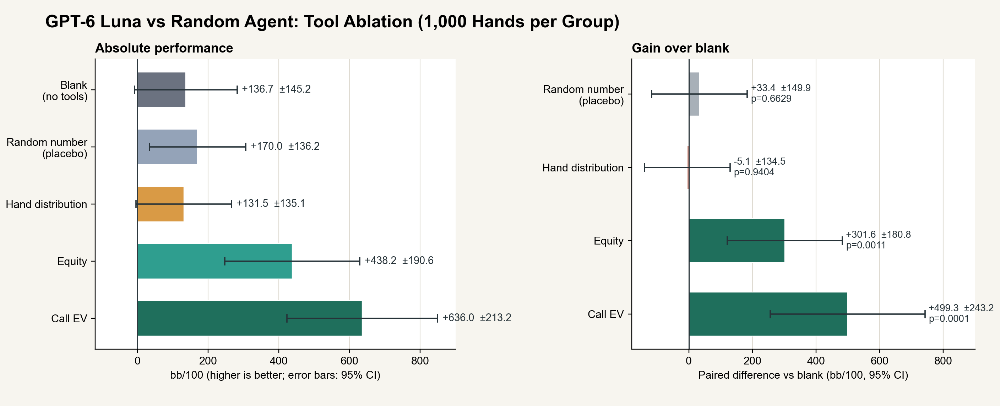
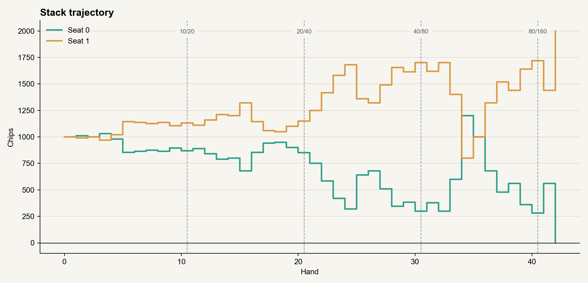

# Heads-Up Lab · Heads-Up No-Limit Texas Hold'em

**English** · [简体中文](README.zh-CN.md)

A lab built specifically for **heads-up no-limit Texas Hold'em**: pick any two of human, LLM, and RLCard to sit at the table. The focus is on laying out the LLM's **reasoning, tool calls, parameters, and results** right next to the table.

- Game engine: strict two-player rules, Treys hand evaluation
- Agents: a fresh game-state message for every action while the full context is kept; five core tools: hand-type probabilities + equity + random number + call EV + apply action
- Table talk: in LLM vs LLM, both sides must speak every action turn (inline `apply_action.table_talk` by default, or the older `send_table_message` tool mode), and can add one post-match line after the result (congratulate, review, tease, or trash-talk). The opponent sees it flagged as untrusted at its next decision; not available for human vs LLM yet
- Match control: the setup sheet can always be closed, a running match can be aborted from the sheet, and client requests time out instead of locking the UI
- Visualization: live reasoning stream, tool cards, tokens/latency, final hand-type distribution, equity/call EV, and both sides' table talk
- God view: both hole cards, burn cards, and the full deck
- LLM: DeepSeek / Volcengine / MiniMax / Qwen / Zhipu GLM / Kimi / LongCat / MiMo / 4Router
- Bots: RLCard (RandomAgent works out of the box; can load DQN/NFSP/DMC checkpoints)
- Language: the interface defaults to English. Switch between 中文 and EN in the top bar or match setup; the choice is saved. `?lang=zh-CN` or `?lang=en` overrides it for one link. Game and API validation errors follow the interface language. Agent locale is recorded separately at match start and controls the system prompt, tool descriptions, tool results, and table talk for that match.

---

## Screenshots

### Table and agent observatory

On the left is the heads-up table, community cards, pot, and action log; on the right is the agent observatory with a live reasoning stream, tool cards, logs, and table talk.

[](docs/screenshots/table.png)

### Match setup

Choose any two of human, LLM, and RLCard; configure provider, model, and reasoning parameters per seat.

[](docs/screenshots/setup.png)

### Reasoning and tool calls

Every action shows the model's reasoning, call EV, equity estimates, and tool results without opening a debugger.

[](docs/screenshots/agent-console.png)

### Hand-type distribution

The final hand-type distribution is normalized by the current maximum probability and labeled with sample count, elapsed time, and estimation method.

[](docs/screenshots/analysis.png)

---

## Quick start

### 1. Python dependencies

```bash
pip install -r requirements.txt
```

Requires Python 3.11+. The project is currently developed on Python 3.13 + Windows.

### 2. Configure keys

```bash
copy .env.example .env        # Windows
cp .env.example .env          # macOS / Linux
```

Fill in the key for each provider in `.env`:

```dotenv
DEEPSEEK_API_KEY=
DOUBAO_API_KEY=
MINIMAX_API_KEY=
QWEN_API_KEY=
GLM_API_KEY=
KIMI_API_KEY=
LONGCAT_API_KEY=
MIMO_API_KEY=
FOURROUTER_API_KEY=
```

`.env` is in `.gitignore` and is never committed. The UI only shows "key configured/missing" and never sends keys to the browser.

### 3. Build the frontend

```bash
cd frontend
npm install
npm run build
cd ..
```

Build output goes to `static/dist/` and is served directly by Flask.

### 4. Run

```bash
python main.py
# or double-click start.bat (it detects and builds the frontend automatically)
```

Open <http://127.0.0.1:5050>.

Dev mode (frontend hot reload):

```bash
python main.py                 # terminal 1, :5050
cd frontend && npm run dev     # terminal 2, :5173, proxied to :5050
```

---

## Features

### Match setup

- Two seats, each choosing **Human / LLM / RLCard**
- Two humans cannot play each other
- Bot seats support an action delay (0 to 10 seconds, default 3) so each move is easy to follow
- Configurable: starting stack, small/big blind, automatic blind increase every N hands, auto rebuy, rebuy amount, max hands, random seed, god view
- Quick presets: Human vs DeepSeek, DeepSeek vs GLM, Human vs RLCard

### God view

When enabled:

- Both hole cards are visible
- Burn cards are visible
- The remaining deck is shown in full, next card on the left
- Hand-type distribution can be computed for either player

God view **only affects the spectator UI**. Agent inputs contain no opponent hole cards and no deck.

### LLM Agent

Each time an LLM is to act:

1. A new `【牌局更新】` (game update) user message is appended with hole cards, community cards, pot, both stacks, amount to call, min/max raise, legal actions, action history for the hand, and recent hand results.
2. The agent keeps the full conversation (across hands and streets). When the context gets too long, the earliest whole turns are trimmed at turn boundaries, keeping the system prompt and recent turns.
3. `estimate_hand_probabilities` is optional and returns the final hand-type distribution. It is not enforced by default; with `require_estimate_first` enabled, a soft reminder appears before the first `apply_action` on each street (it does not count as a failure).
4. `estimate_equity` returns the current showdown equity (`win rate + tie rate / 2`), assuming a random opponent hand by default. River and turn are exact enumerations; flop and preflop use 20,000 Monte Carlo samples each, with LRU caching.
5. `call_ev` computes static call EV from the current pot, call amount, and stacks. The `equity` argument may be omitted, in which case it is estimated automatically; for short-stack all-ins, the unmatched refund is deducted first.
6. If the analysis still leaves several close options, the agent may call `get_random_number` for a uniform `[0, 1)` draw. It is only a tie-breaker, not a substitute for analysis.
7. When both seats are LLM and table talk is enabled at match start, every action turn must include one table-talk message. The default `inline` mode puts it in the `table_talk` argument of `apply_action`, so "say" and "act" travel in one model request; the older `tool` mode calls `send_table_message` first and then `apply_action`, which usually takes two requests per turn. A missing `table_talk` is rejected. After the match, each LLM may add one post-match line based on the result (congratulate, review, tease, or trash-talk). The opponent sees it at its next decision and treats it as untrusted. The system only limits length, format, and frequency; it does not verify truthfulness.
8. A legal `apply_action` advances the turn; an illegal one sends the error, latest constraints, and legal actions back to the model for a retry.
9. Three invalid actions in a row: automatic **call**; if calling is impossible, **fold**. Non-action failures such as network errors or timeouts prefer check/call to avoid pointless folds.
10. Providers that require `reasoning_content` to be echoed (DeepSeek / Qwen / MiniMax / Kimi / GLM, etc.) get it passed back verbatim; unsupported optional parameters are automatically dropped with a retry on HTTP 400.

#### Tools

| Tool | Parameters | What it does |
|---|---|---|
| `estimate_hand_probabilities` | `iterations` optional, 2000-50,000, default 30,000 | Estimates the final best-five hand-type distribution. Exact from the flop onward; Monte Carlo preflop. This is not equity. |
| `estimate_equity` | none | Estimates showdown equity against a random hand (`win + tie / 2`). |
| `get_random_number` | none | Returns a uniform `[0, 1)` number, only for breaking a close decision. |
| `call_ev` | `equity` optional, 0-1 | Computes static call EV, break-even equity, and effective pot; estimates equity when omitted. |
| `apply_action` | `action` required (`fold/check/call/bet/raise/all_in`); `amount` for bet/raise only; `table_talk` in inline table-talk mode | Submits the final action exactly once per turn. `amount` is the street total (raise-to), not the increment. In `inline` mode the first action of a turn must include `table_talk`. |
| `send_table_message` | `text` required | Table talk for LLM vs LLM only; exposed in the older `tool` mode. In `inline` mode the talk goes in `apply_action.table_talk` instead. |

`send_table_message` is exposed only in `tool` mode; `inline` mode keeps the talk inside `apply_action`. The other five are the core tool set. Event and result fields are documented in [`docs/protocol.md`](docs/protocol.md).

#### What the tools are worth

A 1,000-hand-per-group ablation against a uniform random opponent (GPT-6 Luna, DXH relay, `compact_slim`) shows that only the two numeric tools produced a clear gain. Against the blank group, equity gained **+301.6 bb/100** (p=0.0011) and call EV **+499.3 bb/100** (p=0.0001). Hand-type distribution was flat (-5.1, p=0.94), and the random-number placebo was not significant (+33.4, p=0.66). Same deals and seats were mirrored across groups; error bars are 95% CIs.

[](docs/images/dxh_tool_ablation_1000.png)

The opponent is a uniform random agent, so these numbers should not be read as a win rate against a strong bot. They mainly show which tools reduce obvious mistakes: equity and call EV make the agent call and reach showdown more often, while hand-type distribution does not change its decisions much.

#### A complete live self-play match

Two GPT-6 Luna seats also played a full 1,000-chip match through the real Flask + SocketIO backend. With blinds doubling every 10 hands, the match finished in **42 hands and 42.7 minutes**: Luna B won 2,000 to 0. The match cost **¥0.35**, used 17.5M input tokens, and held a **98.0% cache hit rate**. No optional analysis tool was called in 210 turns; the model only used the mandatory table talk and `apply_action`. This run used the older two-step talk protocol: 421 main requests for 210 turns. Inline table talk was added afterwards to bring the normal path down to one request per turn.

[](docs/images/live_match_blinds_stack.png)

A control match with fixed 5/10 blinds reached 63 hands and 4.2 hours without finishing, then was stopped after repeated relay write timeouts. See [`docs/live_llm_match.md`](docs/live_llm_match.md) for both runs, style statistics, tool use, cache, token and timing breakdowns.

### Offline LLM vs LLM evaluation

`scripts/eval_llm_vs_llm.py` supports different tool sets and system prompts for the two seats:

```bash
python scripts/eval_llm_vs_llm.py --hands 100 --workers 5
```

By default, the control group only has `apply_action`; the tool group gets `estimate_hand_probabilities`, `estimate_equity`, `get_random_number`, `call_ev`, and `apply_action` from `ALL_TOOL_NAMES`, and must estimate at least once before every action while fewer than five community cards are visible. Stacks reset each hand, seats are swapped with the same cards, and results go to `tmp/llm_vs_llm/`.

### Data analysis

The hand-type tool shows **the distribution of final best five-card hands** (royal flush, straight flush, four of a kind, full house, flush, straight, three of a kind, two pair, one pair, high card); the equity tool shows win/tie/loss and sampling error; the call EV tool shows EV, break-even equity, and effective pot.

- Preflop: Monte Carlo (30,000 samples by default)
- Flop: exact enumeration over C(47,2) = 1,081 combinations
- Turn: 46 combinations; river: 1
- Results include: current best hand type, method, sample count, elapsed time, absolute probability
- This is not equity; equity also depends on the opponent's range and actions

### RLCard Bot

- Observation encoding matches RLCard `no-limit-holdem` exactly: 54 dimensions, 5 action IDs
- Supports `random` / `dqn` / `nfsp` / `dmc`
- RLCard heads-up postflop order differs from this project's engine (RLCard button/small blind acts first; this project's big blind acts first). Dropping RLCard checkpoints here directly introduces a position bias; benchmark algorithms in the native RLCard environment.
- The default RandomAgent needs no model file; DQN etc. require selecting a model in the config
- Training/loading DQN requires PyTorch: `pip install -r requirements-optional.txt`
- Training:

```bash
python scripts/train_rlcard.py --episodes 50000 --chips 1000 --reward-scale 0.01
```

Output `models/rlcard/nlh_dqn.pth`; choose **RLCard → DQN → model file** in the UI. See [`models/rlcard/README.md`](models/rlcard/README.md).

### Project-rule RL Bot

- Trained with this project's `HeadsUpGame` rules, 73-dim observation, 10 action slots (fold/check/call/min-raise/1/3, 1/2, 3/4, pot, 1.5x pot/all-in).
- DQN / NFSP:

```bash
python scripts/train_project_bot.py --algorithm dqn --hands 100000 --opponent mix
python scripts/train_project_bot.py --algorithm nfsp --hands 100000 --opponent mix
```

- Offline matrix evaluation:

```bash
python scripts/eval_project_bots.py --hands 2000
```

Models are written to `models/rlcard/nlh_dqn_project.pth` / `nlh_nfsp_project.pth`. Choose **Project DQN** or **Project NFSP** in the UI. Training details: [`docs/training.md`](docs/training.md).

> Note: the RL models in this repo are experimental training artifacts. In my opinion they perform poorly right now; treat them as reference only, not as strong bots.

---

## LLM integration

All providers use the OpenAI-compatible `/chat/completions`, with parameters adapted per vendor.

| Provider | Base URL | Model | Key | Notes |
|---|---|---|---|---|
| DeepSeek | `https://api.deepseek.com` | `deepseek-flash` | `DEEPSEEK_API_KEY` | 1M context, `thinking` + `reasoning_effort`, tool turns must echo reasoning_content |
| Volcengine | `https://ark.cn-beijing.volces.com/api/v3` | `doubao-seed-2-1-turbo-260628` | `DOUBAO_API_KEY` | `thinking.type` toggle, OpenAI-compatible |
| MiniMax | `https://api.minimaxi.com/v1` | `MiniMax-M3.1-Flash` | `MINIMAX_API_KEY` | Always reasoning, ignores temperature/top_p, supports `reasoning_effort` |
| Qwen | `https://dashscope.aliyuncs.com/compatible-mode/v1` | `qwen3.8-flash` | `QWEN_API_KEY` | `enable_thinking`, `preserve_thinking`, thinking-mode temperature ≥0.6 |
| Zhipu GLM | `https://open.bigmodel.cn/api/paas/v4` | `glm-5.3-flash` | `GLM_API_KEY` | Reasoning always on, `reasoning_effort` low/high/max, streaming tool calls |
| Kimi | `https://api.moonshot.cn/v1` | `kimi-k2.7-code` | `KIMI_API_KEY` | Forced reasoning, 262K context, tool calls |
| LongCat | `https://api.longcat.chat/openai/v1` | `LongCat-2.5-Preview` | `LONGCAT_API_KEY` | `thinking.type` toggle, 1M context, native tools |
| MiMo | `https://api.xiaomimimo.com/v1` | `mimo-v2.6-flash` | `MIMO_API_KEY` | `thinking.type` toggle, 1M context, echoes reasoning_content |
| 4Router | OpenAI-compatible | `gpt-6-luna` | `FOURROUTER_API_KEY` | Always reasoning, adjust depth with `reasoning_effort`; does not return reasoning text |

Parameters are not "the more conservative, the better": the default `max_tokens` is **32,768**, each vendor allows different upper limits, and the UI shows ranges and suggested values. Default temperature follows vendor recommendations (e.g., DeepSeek/GLM 1.0, Qwen 0.7, MiniMax ignores it).

Each model has a **Test connection** button that sends a very short request and displays latency.

---

## Project structure

```
main.py                       # entry point
config/
  game.json                   # rule defaults / limits / LLM runtime
  providers.json              # 9 providers, models, parameter controls
src/
  engine/                     # Card / Deck / Treys evaluation / two-player state machine
  analysis/                   # hand-type distribution (exact enumeration + Monte Carlo + cache)
  agents/                     # AgentView, RLCardBot
  llm/                        # providers / streaming client / prompt / tool loop
  server/                     # Flask + Socket.IO + GameSession thread
frontend/                     # Vue 3 + Vite + TypeScript
  src/components/             # table, agent console, analysis, setup modal
  src/store.ts                # socket + incremental event reducer + state sync
static/dist/                  # frontend build output (gitignored)
tests/                        # engine / analysis / LLM tool loop / RLCard adapter
scripts/train_rlcard.py       # DQN training
scripts/eval_llm_vs_bot.py    # offline LLM vs Project Bot evaluation
scripts/eval_llm_vs_llm.py    # LLM vs LLM tool-use comparison
models/rlcard/                # checkpoint directory (files are gitignored)
```

Offline LLM evaluations default to Chinese agent prompts. Pass `--agent-locale en-US` to `eval_llm_vs_bot.py`, `eval_llm_vs_llm.py`, or `eval_llm_tool_matrix.py` to run the English prompt and tool layer.

---

## Tests

```bash
pip install -r requirements-dev.txt
python -m pytest tests -q
cd frontend && npm run typecheck && npm test && npm run build
```

Current coverage:

- Blinds/position, minimum raise, short-stack all-in does not reopen betting, no raising after the opponent is all-in, fold refunds, split pot at showdown, chip conservation over 60 random hands
- Exact/Monte Carlo hand-type distribution, duplicate-card rejection, cached seat keys, and LRU
- LLM tool loop, SSE chunking, tool-call merging, non-streaming fallback, disconnect retention, cancellation, error redaction
- Atomic match creation, strict rule validation, JSON type validation
- RLCard action legality and 54-dim observation encoding consistency

---

## Known limitations

- Single process, in-memory, one table only; matches are lost when the service restarts
- No login/auth; listens on `127.0.0.1` by default, do not expose it directly to the public internet
- Socket.IO only accepts local origins `5050` and `5173` by default; set `HU_ALLOWED_ORIGINS` for other ports or hosts
- God view is a spectator feature and never enters agent context
- LLM `reasoning_content` is raw vendor output; different models may reason in English
- Short RLCard training easily degrades; use RandomAgent to validate the pipeline and evaluate trained models yourself
- Model files are PyTorch pickles; only load trusted sources; model paths are restricted to `models/rlcard/`
- LLM calls cost vendor money; "Test connection" also sends a tiny real request
- No opponent range inference; equity and call EV assume a random opponent hand by default

---

## Stack and acknowledgements

- [Treys](https://github.com/ihendley/treys): TwoPlusTwo lookup-table hand evaluation
- [RLCard](https://github.com/datamllab/rlcard): reinforcement-learning poker environments and agents
- [DeepSeek V4.1 Flash](https://www.deepseek.com): the AI development assistant for this project, contributing to code, debugging, and documentation
- [OpenCode](https://opencode.ai): AI agent runtime and development tooling
- Flask / Flask-SocketIO / Vue 3 / Vite / TypeScript
- Provider icons are brand marks of their respective vendors, used only for UI identification; all rights belong to their owners

## License

MIT, see [LICENSE](LICENSE). Third-party brand icons and third-party models are not covered by the MIT license.

Human table shortcuts: **F** fold, **C** check/call, **R** focus raise, **A** all-in.
