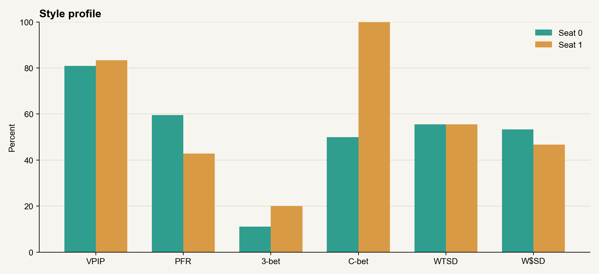
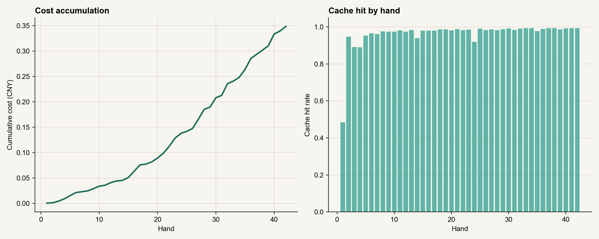
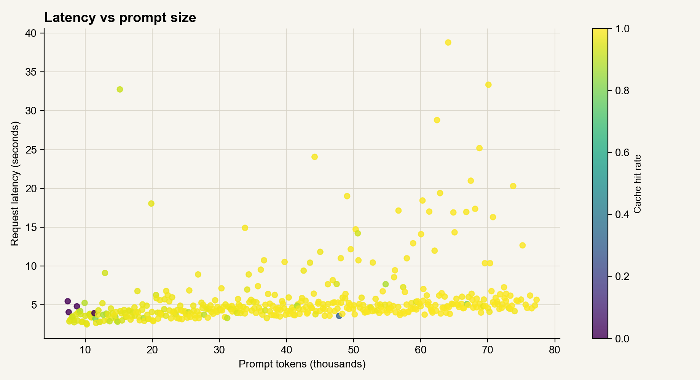
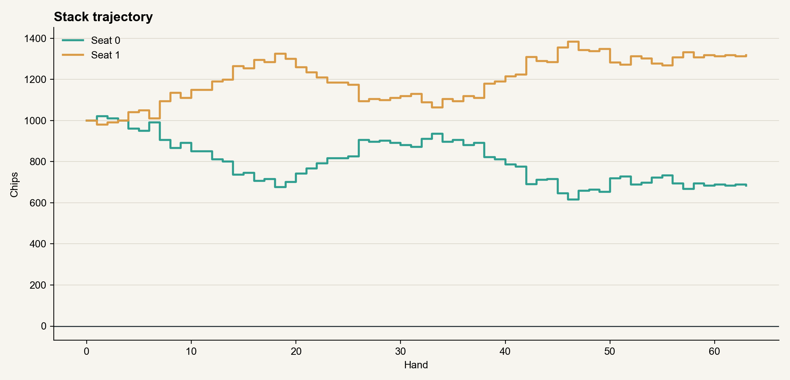

# 真实后端 LLM 自对弈实验（2026-10-25）

> 2026-10-26 起默认 `table_talk_mode=inline`：喊话放进 `apply_action.table_talk`，正常路径一次请求完成“说 + 做”。本报告的 421 次主对局请求 / 210 个 turn 是旧的两步 tool 模式基线，用来对照 inline 模式的请求数和延迟。

## 目的

在真实 Flask + SocketIO + `GameSession` 后端里，让两个 GPT-6 Luna 完整对打，观察：

- 打牌风格和公共统计指标
- 一场完整比赛要打多久
- 模型会主动调用哪些工具
- 缓存命中、token 和费用
- 长对局下的上下文和限速表现

与离线 `eval_llm_vs_bot.py` 不同，这里走真实的对局线程、桌边喊话、赛后喊话、`checkpoint` 上下文和 `research_history` 工具。

## 设置

- 模型：两边都是 `dxh/gpt-6-luna`
- 推理：`reasoning_effort=low`
- 筹码：1000
- 起始盲注：5 / 10
- 重购：关闭
- 手数上限：不设，打到一方筹码归零
- 桌边喊话：开启
- 上下文：默认 `checkpoint`
- 语言：中文
- 数据采集：服务端 `socketio.emit` 出口直接落盘，避免 SocketIO 客户端重连丢事件

## 两场概览

| 项目 | 5/10 深筹码 | 5/10 + 盲注递增 |
|---|---:|---:|
| 手数 | 63（未打完） | 42（完整） |
| 时长 | 249.9 分钟 | 42.7 分钟 |
| 结束方式 | 中转限速，手动停止 | Luna B 赢下全部筹码 |
| 最终筹码 | 658 / 1292 | 0 / 2000 |
| 费用 | ¥0.8516 | ¥0.3485 |
| 输入 token | 42,813,686 | 17,468,075 |
| 缓存命中 | 97.9% | 98.0% |
| checkpoint 压缩 | 0 | 0 |
| 模型请求错误 | 5 | 0 |
| 自动行动 turn | 5 | 0 |
| 可选工具调用 | 1 | 0 |

## 完整比赛：盲注递增

盲注每 10 手翻倍：

| 手数 | 盲注 | 实际手数 |
|---|---|---|
| 1–10 | 5 / 10 | 10 |
| 11–20 | 10 / 20 | 10 |
| 21–30 | 20 / 40 | 10 |
| 31–40 | 40 / 80 | 10 |
| 41–42 | 80 / 160 | 2 |


### 风格

| 指标 | Luna A（Seat 0） | Luna B（Seat 1） |
|---|---:|---:|
| VPIP | 81.0% | 83.3% |
| PFR | 59.5% | 42.9% |
| Limp | 0.0% | 14.3% |
| 3-bet | 11.1%（n=18） | 20.0%（n=25） |
| Fold to 3-bet | 80.0%（n=5） | 0.0%（n=2） |
| Steal | 100.0%（n=21） | 61.9%（n=21） |
| C-bet | 50.0%（n=8） | 100.0%（n=10） |
| Fold to c-bet | 50.0%（n=10） | 25.0%（n=4） |
| 翻后攻击率 | 25.0% | 75.0% |
| WTSD | 55.6% | 55.6% |
| W$SD | 53.3% | 46.7% |



翻前加注中位：Luna A 3.0 BB，Luna B 2.5 BB。翻后下注/加注占底池中位：Luna A 34.2%，Luna B 44.2%。

Luna A 翻前更愿意加注，翻后偏被动；Luna B 翻前跟注更多，但翻后持续施压，c-bet 100%，空气牌攻击率也更高。最终 Luna B 赢下比赛。

### 工具

| 工具 | 调用次数 |
|---|---:|
| `send_table_message` | 210 |
| `apply_action` | 211 |
| `research_history` | 0 |
| `estimate_hand_probabilities` | 0 |
| `estimate_equity` | 0 |
| `get_random_number` | 0 |
| `call_ev` | 0 |

210 个 turn 里没有任何一次可选工具调用。模型全程只用了强制的喊话和提交动作。唯一一次工具错误是下注低于最小下注，随后自己重试成功。

这和之前“强烈推荐工具”的 1000 手实验完全不同。默认系统提示词把工具描述为可选，模型在真实对局里几乎不会主动查胜率、牌型分布或历史统计。

### 缓存、token 和费用

| 指标 | 值 |
|---|---:|
| 主对局模型请求 | 421 |
| 输入 token | 17,468,075 |
| 缓存输入 | 17,114,880 |
| 缓存 miss | 353,195 |
| 输出 token | 26,552 |
| 总体缓存命中 | 98.0% |
| 每手第一条请求命中 | 97.8% |
| 同 turn 后续请求命中 | 98.4% |
| 主对局费用 | ¥0.3483 |
| 赛后喊话 | ¥0.0002 |
| 总费用 | ¥0.3485 |
| 平均每手 | ¥0.0083 |



上下文没有触发 196K 的 checkpoint 阈值，最长一段在 50K 到 100K token 之间。缓存命中接近 98%，请求中位延迟 4.6 秒，95 分位 14.2 秒。



### 节奏

- 总时长 42.7 分钟，42 手，平均 1.02 分钟/手
- 每手墙钟中位 52.3 秒，95 分位 113.5 秒
- 每个 turn 中位 9.4 秒，95 分位 23.9 秒
- 模型请求总耗时约 40.1 分钟，赛后喊话约 0.16 分钟
- 2 次赛后喊话正常生成

### 桌边喊话

- 共 212 条，Luna A 110 条，Luna B 102 条
- 平均 29.5 字，最长 39 字
- 赛后喊话各一条，双方都提到 42 手和最终结果

样例：

> Luna A：盲注阶段就把底池让出来可不划算，我会让你在翻后继续猜。

> Luna B：这点加注还不足以让我紧张，翻后再看你能不能兑现。

## 未完成比赛：5/10 深筹码

这场没有盲注递增，打到 63 手时筹码 658 / 1292，离结束还很远。最后 5 手每手一次 `network` 写入超时，自动弃牌，因此手动停止，保留为限速压力案例。



| 指标 | Luna A | Luna B |
|---|---:|---:|
| VPIP | 85.7% | 69.8% |
| PFR | 30.2% | 57.1% |
| 3-bet | 5.6%（n=36） | 5.3%（n=19） |
| C-bet | 100.0%（n=9） | 82.6%（n=23） |
| 翻后攻击率 | 30.0% | 70.0% |
| WTSD | 66.7% | 66.7% |
| W$SD | 45.8% | 62.5% |

这场只有 1 次可选工具调用（`estimate_equity`），347 个 turn 里可选工具调用率接近 0。

## 结论

1. **盲注递增是让完整比赛可结束的关键。** 同样 1000 筹码、5/10 起始，深筹码场 63 手还没结束；每 10 手翻倍后 42 手、43 分钟结束。
2. **默认提示词下，GPT-6 Luna 几乎不主动用分析工具。** 两场合计 557 个 turn，只调用过 1 次 `estimate_equity`。工具消融里的正向效果依赖“强烈推荐工具”的附加提示，不能直接外推到真实默认对局。
3. **缓存非常稳定。** 两场都在 97.9% 到 98.0%，即使没有 checkpoint 压缩。DXH 的缓存输入和普通输入同价，所以高命中主要降低延迟，不直接降低按 token 计的费用。
4. **费用很低。** 完整 42 手约 ¥0.35，平均每手不到 1 分钱。
5. **同一模型会自然分叉出不同桌风。** Luna A 偏松、翻前加注多、翻后被动；Luna B 翻前跟注多、翻后持续施压。单场不能当成稳定风格画像。

## 注意

- 每场只有一个样本，VPIP、3-bet、c-bet 的置信区间很宽。
- 对手是同模型的另一个实例，不能据此判断模型对强 Bot 或人类的强弱。
- 5/10 深筹码场不是完整比赛，数据只用于观察长对局、限速和缓存。
- 盲注递增会改变有效筹码深度，后期全下频率明显上升；它适合让实验收尾，不等同于标准 100 BB 单挑。

## 复现

```bash
# 2 手冒烟，验证真实后端、桌边喊话、自动下一手和盲注递增
python scripts/run_live_llm_match.py --max-hands 2 --blind-increase-every-hands 1 --seed 3 --output tmp/live_match/smoke_blinds

# 完整比赛：5/10 起始，每 10 手翻倍
python scripts/run_live_llm_match.py --seed 20261026 --blind-increase-every-hands 10 --blind-increase-factor 2 --output tmp/live_match/full_blinds

# 生成报告和图表
python scripts/report_live_match.py --run tmp/live_match/full_blinds
```

如果进程在比赛结束前被终止，可以先从事件日志恢复公开手牌记录：

```bash
python scripts/reconstruct_live_match.py --run tmp/live_match/full
python scripts/report_live_match.py --run tmp/live_match/full
```

